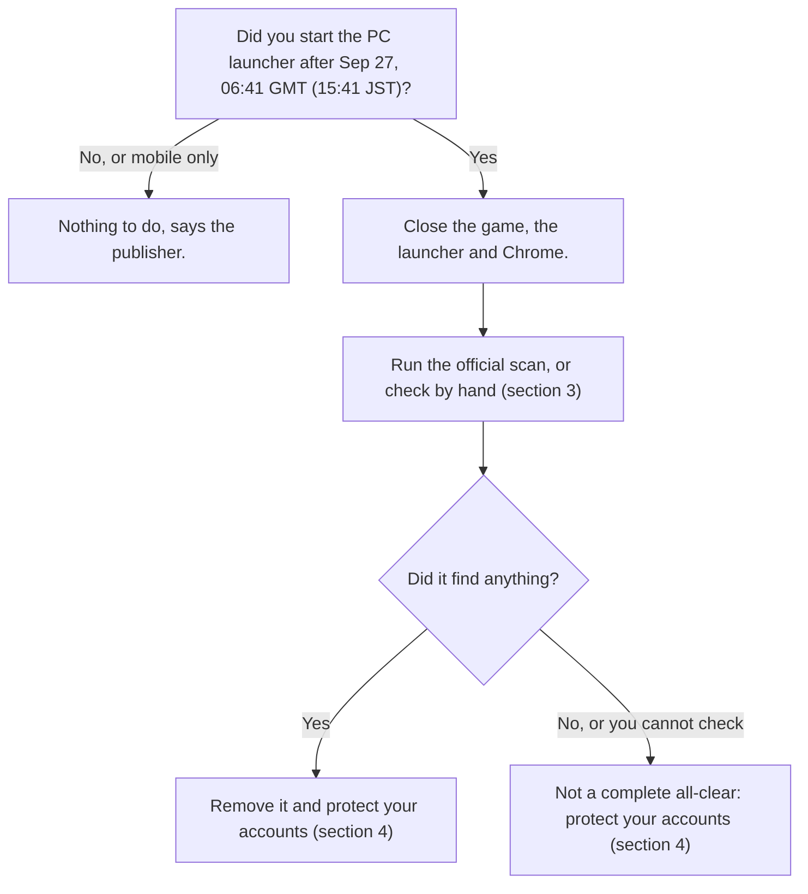

# NIKKE PC launcher incident: what to do, and what not to do

> [!IMPORTANT]
> **Follow the publisher's guidance.** Level Infinite (NIKKE's publisher) confirms that a third party tampered with PC launcher files and says the current launcher version is safe to use. It gives two ways to check and clean a PC: the official scan built into the PC client (from Nov 5, 08:00 JST, which is Nov 4, 23:00 GMT) and a manual check guide ([English post](https://x.com/NIKKE_en/status/2118118928631451774)). It also asks everyone who ran the PC launcher to change their passwords and to revoke API keys and tokens. This guide summarises those steps in [section 2](#2-what-to-do-now-official-guidance). According to the publisher, players who only played on mobile need to do nothing.

> [!NOTE]
> Community guide. **Not an official statement.** Not affiliated with SHIFT UP, Level Infinite or Tencent, and not professional incident-response advice. The publisher's notices come first. Besides them we use our own checks of public data (domain registries, certificate logs, the official CDN files) that anyone can repeat: see [ANALYSIS.md](ANALYSIS.md). [MotherSphere's technical report](https://gist.github.com/MotherSphere/d6c049a09ba8ac3085c51ee9df24a4e5) was written by a private individual and is **not confirmed by the publisher**, and we found no security vendor advisory confirming it, so we treat its claims as unconfirmed and do not base advice on them. Prepared with AI assistance.

> [!TIP]
> If you want to keep your evidence, copy `Launcher\intl_service\debug.log` before you run the official scan, because the scan deletes what it finds. This is our suggestion, not an official step.

**Last updated: 2026-11-05, 00:15 GMT**. Things are still changing, so look at the date. Changes are listed in the [changelog](#changelog).

| Status board | Now | Checked (GMT) |
|---|---|---|
| Official CDN files | All four byte-identical to the known-clean versions, on every server tested (our check) | Nov 4, 23:44 |
| Publisher statements | Nov 4, 23:00 to 23:13: Level Infinite apologises and posts a follow-up measures notice. It confirms that a third party tampered with launcher files, says PCs and account data may have been exposed and the scope is still being investigated, calls the current launcher version safe, and announces compensation. SHIFT UP's Kim Hyung-tae says the launcher was updated with a scanning tool that runs at launch. Earlier: first notice 03:14, Kim Hyung-tae 08:07 | Nov 4, 23:46 |
| Official removal tool | From Nov 5, 08:00 JST (Nov 4, 23:00 GMT) the official PC client scans for the malware and offers to remove it. Announced, not tested here | Nov 4, 23:46 |
| Official manual check guide | Published Nov 4, 23:10 to 23:11 GMT (English, Korean, Japanese). Section 3 follows its steps | Nov 4, 23:46 |
| Community report (unofficial) | A private individual's technical report, not confirmed by the publisher. Still being edited (21 revisions, newest Nov 4, 23:23, and 181 comments). This guide does not base advice on it | Nov 4, 23:46 |
| Stolen data being misused | No public report found in the community comments (absence of reports, not proof). The publisher says only that PCs and accounts may have been exposed | Nov 4, 23:44 |
| Attacker's server | The host, 1984 ehf, told us it shut down a server (not named). The domain's DNS still points to the old address and is not suspended yet (our check). Abuse reports to the host and the registrar are filed (ANALYSIS row 31) | Nov 4, 23:44 |

## Contents

1. [Start here](#1-start-here)
2. [What to do now (official guidance)](#2-what-to-do-now-official-guidance)
3. [Check your PC by hand (official steps)](#3-check-your-pc-by-hand-official-steps)
4. [What to do with the result](#4-what-to-do-with-the-result)
5. [Myths and facts](#5-myths-and-facts)
6. [What is known, and how well](#6-what-is-known-and-how-well)
7. [Timeline (GMT)](#7-timeline-gmt)
8. [Do not get scammed](#8-do-not-get-scammed)
9. [What players still need from SHIFT UP and Level Infinite](#9-what-players-still-need-from-shift-up-and-level-infinite)
10. [Unofficial extras from the community report](#10-unofficial-extras-from-the-community-report)
11. [Changelog](#changelog)
12. [Sources and credit](#sources-and-credit)

## 1. Start here



Why Sep 27? The publisher says `insightjs.com` was taken over that day and four launcher script files were modified (15:41 to 15:42 JST). It says malware distribution to PCs began on Oct 30 at 03:52 JST (Oct 29, 18:52 GMT), the response started on Nov 4 at 00:00 JST, and the files were fixed on Nov 4 between 02:04 and 02:23 JST (the last file and the CDN cache at 12:09 JST). The publisher gives no end date for the check: anyone who started the PC launcher after Sep 27 should check. Our own registry and CDN checks fit the publisher's times (section 6).

**Being exposed is not the same as being infected.** The publisher says PCs and account data "may have been exposed" and that the scope is still being investigated. That is why it publishes a check, and why it says that not finding the string does not completely rule out risk.

## 2. What to do now (official guidance)

From Level Infinite's follow-up measures notice (read in the Korean original, the wording below is ours), its English apology and its manual check guide:

- **Who should check:** anyone who started the PC launcher at least once after Sep 27, 06:41 GMT (15:41 JST). The incident was limited to the PC launcher, so players who only played on mobile need to do nothing.
- **Official scan:** from Nov 5, 08:00 JST (Nov 4, 23:00 GMT) the official PC client scans for the malware and removes it. Close Chrome and other browsers first, then start the client. If something is found, a popup asks whether to remove the malware's logs, DLLs and registry data, and agreeing deletes them. If a browser was still open, some DLL files may stay, but they no longer run. No popup means nothing was found. The publisher admits the popup is not polished yet, and calls this security feature ACE. SHIFT UP's Kim Hyung-tae adds that the launcher was updated so that a scanning tool checks security at launch.
- **Manual check** (no launcher installed, or you prefer to check by hand): the publisher's manual guide is out ([English post](https://x.com/NIKKE_en/status/2118118928631451774), steps on the [official page](https://nikke-en.com/newsdetail.html?content_id=ecdccd40a55a5a46aaa9abda64d436082db7)). The steps are in section 3.
- **Account protection** (from another device, or after the PC check): change the passwords of accounts you used on that PC, and revoke and reissue any API keys and access tokens you used or stored on it.
- **Losses outside the game** (accounts, money): contact the official in-game Customer Support, which promises to review each case.
- **The launcher:** the apology says the currently distributed version is safe to use. Our own checks agree that the official files are clean (section 6).
- **No Windows reinstall is asked for.** None of the publisher's notices we read asks players to reinstall or reset Windows. Its steps are the removal, antivirus and account steps above and in section 3.
- **Our note, not an official step:** the official scan deletes what it finds, and `debug.log` sits in the NIKKE folder, so deleting that folder deletes it too. If you want a record of the evidence, copy `Launcher\intl_service\debug.log` first.
- **Do not run "fix" tools from anyone**, including strangers on social media (section 8).

Sources: [English apology](https://x.com/NIKKE_en/status/2118116340225732677), [Korean follow-up measures notice](https://x.com/NIKKE_kr/status/2118117786568560774) (links to the official page on nikke-kr.com), [manual check guide, English post](https://x.com/NIKKE_en/status/2118118928631451774).

## 3. Check your PC by hand (official steps)

These are the steps of the publisher's manual check guide, in the publisher's order ([English post](https://x.com/NIKKE_en/status/2118118928631451774), full text on the [official page](https://nikke-en.com/newsdetail.html?content_id=ecdccd40a55a5a46aaa9abda64d436082db7)). Nothing to download. We checked this section against the official page on 2026-11-05, 00:15 GMT.

**Step 1. Prepare.** Disconnect your PC from the network and completely close the NIKKE game, the PC launcher and Google Chrome. Look at the system tray (bottom right of the screen) to make sure no NIKKE icon remains. The publisher recommends that you do not start the launcher again until the check is complete.

**Step 2. Check the log.** Right-click the NIKKE icon on your desktop and choose "Open file location". Find `Launcher\intl_service\debug.log` (for example `C:\NIKKE\Launcher\intl_service\debug.log`, or `C:\NIKKE_GOOGLE\Launcher\intl_service\debug.log` for Google Play Games). Open it with Notepad, press Ctrl+F and search for `k2f_chan registered`.

- **Found:** a malicious program may have run on your PC. Continue with step 3.
- **Not found:** the publisher says this does not completely rule out risk. Update your antivirus to the latest version and run a full system scan (step 5).

**Step 3. Remove the malicious program.** These steps change files and registry entries. Check each path carefully and do not delete anything else.

1. **Registry entry.** Press Win+R, enter `regedit`, go to `HKEY_CURRENT_USER\Software\Classes\CLSID` and look for `{E77CC89B-7401-4C04-8CED-149DB35ADD04}`. If it exists, delete it. An entry with the same name may exist under other paths: delete only the one at this exact path.
2. **Restart Windows.**
3. **DLL.** After the restart, press Win+R and open `%LOCALAPPDATA%\Google\Chrome\User Data\`. Inside the `PlatformExperienceHelper` folder, look for a subfolder whose name is exactly 64 hexadecimal characters (0 to 9 and lowercase a to f) and that contains `platform_experience_helper.dll`. Only if both are true, delete that subfolder. The `PlatformExperienceHelper` folder may hold legitimate Chrome files, so do not delete the whole folder. If it does not exist, the DLL was not installed.
4. **Download file.** In the NIKKE launcher folder open `Launcher\log\tinyget` and delete any file of 205,135 bytes (about 200 KB) with a name like `tinyget.<date>-<time>.log`. If there is none, go on.
5. **Local cache.** Press Win+R, open `%APPDATA%\nikke_launcher` and delete the entire `tbs_cache` folder.

**Step 4. Account security.** From a different device that has not been affected, or after you finish the PC check: change the passwords of the accounts you used on that PC, and revoke and reissue the API keys and access tokens you used or stored on it (more in section 4).

**Step 5. System security scan.** Update Windows Security or another trusted antivirus to the latest version, then run a full system scan and a Windows Security Offline Scan (Microsoft Defender).

If you still see unusual activity after all steps, contact the official Customer Support.

**Our note, not an official step:** if `debug.log` does not exist (for example after an uninstall), the official page does not say what to do. You can still look for the registry entry and the DLL folder (step 3, items 1 and 3) and delete the `tbs_cache` folder (item 5).

**Prefer a script?** [`Check-NikkeLauncher.ps1`](Check-NikkeLauncher.ps1) checks the log, the registry key and the DLL folder, plus a few extras. It is plain PowerShell, offline and read-only, and short enough to read in five minutes. Read it first. Do not run scripts you have not read, including this one. It is our own helper, not an official tool: the official scan and the manual steps above come first. The community report links its author's own scanner. We have not reviewed its current release, and we do not recommend it over the official scan. The only review published here covers v0.4.0 ([community/](community/README.md)).

```
powershell -NoProfile -ExecutionPolicy Bypass -File .\Check-NikkeLauncher.ps1
```

## 4. What to do with the result

| Result | What to do |
|---|---|
| **Found:** `k2f_chan registered` in the log, or the official scan finds something | Remove it: accept the removal the official scan offers, or follow step 3 of section 3. Then do steps 4 and 5 (accounts, antivirus scans). |
| **Not found** | The publisher says this does not completely rule out risk. Update your antivirus and run a full scan and a Windows Security Offline Scan (step 5), and protect your accounts (step 4) if you ran the launcher after Sep 27. |
| **Cannot check** (log gone, launcher uninstalled) | The publisher's guide does not cover this case directly. Our note, not official: look for the registry entry and the DLL folder (step 3, items 1 and 3), delete `tbs_cache` (item 5), do step 5, and protect your accounts (step 4). |
| You did not start the PC launcher after Sep 27, or played only on mobile | Nothing to do, says the publisher. |

### Protect your accounts

From the publisher's notice (step 4 of section 3):

1. **From another device**, change the passwords of the accounts you used on that PC. Start with NIKKE / Level Infinite, then email and everything else you used there.
2. **Revoke and reissue** the API keys and access tokens you used or stored on that PC.
3. **Losses outside the game:** contact the official in-game Customer Support.

General advice, not from the notice: turn on 2FA, sign out of all sessions, look at the recent-activity pages of your important accounts for logins you do not recognise, and treat crypto wallets and SSH keys that were on that PC as exposed.

### What about reinstalling Windows?

The publisher does not ask for it, so we do not recommend it. The community report's author suggests it after a confirmed infection as the only certain fix. That is not official advice (ANALYSIS rows 18 and 28). If your PC holds high-value secrets, you can decide for yourself or ask a professional.

## 5. Myths and facts

| You may hear | What is known |
|---|---|
| "It's a hoax." | No. SHIFT UP's and Level Infinite's own notices confirm that a third party tampered with launcher files, and our registry and CDN checks fit the times the publisher gave. |
| "It's just one person's PC, a minor local issue." | No. The publisher confirms the tampering, replaced the official files, published an official scan and a manual check, and asks everyone who ran the PC launcher to protect their accounts. |
| "Everything on every PC was stolen." | Nobody can say that. The publisher says PCs and account data may have been exposed and that the scope is still being investigated. |
| "The attacker had no time, nothing was stolen." | Nobody can say that either. We found no public report of stolen data being misused, which is not proof that nothing was taken. |
| "A clean log means I'm safe." | The publisher says that not finding the string does not completely rule out risk. |
| "The launcher showed a security warning, so I'm infected." | Not by itself. The warning page is on `insightjs.org`, a domain registered on Nov 3, after the incident became public. By the community report's explanation, the warning means the modified script loaded, not that anything else ran. The publisher has not confirmed this. Run the official scan or the manual check. |
| "I have to wipe or reinstall Windows." | The publisher does not ask for it. Its steps are removal of the listed items, an antivirus scan, and changing passwords and keys. |
| "I have to switch off my PC for good." | No. The manual guide asks you to disconnect from the network and close the game, the launcher and Chrome while you check. |
| "Uninstalling the launcher fixes it." | Not by itself. The items the manual guide tells you to delete (the registry key and the Chrome DLL folder) are outside the NIKKE folder, and uninstalling also deletes `debug.log`. |
| "Changing my NIKKE password is enough." | It is the first step, not the only one. The publisher also asks you to change the passwords of other accounts you used on that PC and to revoke API keys and tokens. |
| "Only Windows is affected." | The publisher says the incident was limited to the PC launcher. Mobile players need to do nothing. |

### Short answers you can copy

Short replies for people asking in threads and chats. Each one fits in a post.

- **"Do I need to wipe Windows?"** The publisher does not ask for it. Follow its steps: the official scan or the manual check, then change passwords from another device and revoke API keys and tokens. https://github.com/SpringZali/nikke-launcher-triage
- **"I already uninstalled it. Am I fine?"** Not necessarily, and you cannot check the log any more. The publisher's manual guide is meant for people without the launcher too. Our suggestion: look for the registry key and the Chrome DLL folder, delete `tbs_cache`, scan with your antivirus, and change passwords from another device. https://github.com/SpringZali/nikke-launcher-triage
- **"Is it a hoax?"** No. SHIFT UP and Level Infinite confirm that a third party tampered with launcher files. What is not confirmed yet is the scope of the damage. https://github.com/SpringZali/nikke-launcher-triage
- **"I saw a security warning in the launcher. Am I hacked?"** Not necessarily. Run the official scan or the manual check: search `debug.log` for `k2f_chan registered`. https://github.com/SpringZali/nikke-launcher-triage
- **"Is the launcher safe to open now?"** Level Infinite says the current launcher version is safe, and our checks agree that the official files are clean. Use the official client's scan (from Nov 4, 23:00 GMT). https://github.com/SpringZali/nikke-launcher-triage
- **"Can I just reinstall it to remove the malware?"** Not by itself: the items to delete (the registry key and the Chrome DLL folder) sit outside the NIKKE folder. Check by hand first, as the official guide describes. https://github.com/SpringZali/nikke-launcher-triage
- **"Can a System Restore fix it?"** We would not rely on it. The publisher's steps are to delete specific items and scan. https://github.com/SpringZali/nikke-launcher-triage

## 6. What is known, and how well

**VERIFIED** = reproduced from a public source, or read at the source. **CORROBORATED** = several independent reports agree. **REPORTED** = one source. **UNOFFICIAL** = a claim or advice from the community report that the publisher does not make. Full table with 36 claims and how to reproduce each: [ANALYSIS.md](ANALYSIS.md).

**From the publisher**

| Fact | How well established | Source |
|---|---|---|
| A third party tampered with launcher files, and PCs and accounts may have been exposed | **VERIFIED** (read at the source) | Level Infinite's [apology](https://x.com/NIKKE_en/status/2118116340225732677) and [follow-up notice](https://x.com/NIKKE_kr/status/2118117786568560774), Nov 4 |
| The publisher reports an anomaly consistent with tampering and applied a client fix | **VERIFIED** | [Official notice, Nov 4](https://x.com/NIKKE_japan/status/2117817740555956289) |
| The current launcher version is safe to use | **REPORTED** by the publisher | The same notices. Our checks agree that the official files are clean (below) |
| The official PC client scans for and removes the malware from Nov 4, 23:00 GMT | **REPORTED** by the publisher | The notice. Not tested here, on purpose |
| The manual check: `k2f_chan registered` in `debug.log`, a registry key, a Chrome DLL folder, a 205,135-byte `tinyget` log, `tbs_cache`, an antivirus scan | **VERIFIED** (read at the source) | The [English post](https://x.com/NIKKE_en/status/2118118928631451774) and the official page it links |
| Timeline: `insightjs.com` taken over Sep 27, malware distributed to PCs from Oct 29, 18:52 GMT | **REPORTED** by the publisher | The notice. The dates fit our registry and file checks |

**From our own checks of public data**

| Fact | How well established | Source |
|---|---|---|
| The official files were replaced on Nov 3 between 17:04 and 17:21 GMT | **VERIFIED** | Current `Last-Modified` headers on the CDN |
| The files served now are the clean versions | **VERIFIED** | [`Check-OfficialCdn.ps1`](Check-OfficialCdn.ps1) |
| `insightjs.com` was registered Sep 27 and `insightjs.org` Nov 3 | **VERIFIED** | Domain registry records |
| Certificates were issued for the attacker's domain on Sep 27, Oct 6, Oct 23 and Oct 24 | **VERIFIED** | Certificate transparency log |
| The attacker's domain still points to a server of the host 1984 ehf and is not suspended | **VERIFIED** (registry and DNS only) | ANALYSIS rows 2, 5 and 31 |

**From the community report (unofficial, unconfirmed)**

| Fact | How well established | Source |
|---|---|---|
| The malicious program is a remote-control agent that can run commands, read files, take screenshots and collect saved credentials | **REPORTED**, **UNOFFICIAL** | Static analysis by one private individual, not verified here. The publisher says only "malicious programs" |
| The Chrome-helper persistence is not on every infected PC | **REPORTED** | Victims' comments. The publisher's guide lists the registry key and the DLL as traces to look for |
| Reinstalling Windows is the only certain fix | **UNOFFICIAL** | The report's author. The publisher does not say so |
| Stolen data is being misused | **NO REPORTS FOUND** | Keyword scan of the report's comments (last full scan 16:03 GMT, later comments read one by one) |
| One detailed community case study also found no proof of theft or misuse | **REPORTED** | [Community report](community/INCIDENT_FORENSIC_REPORT_PUBLIC.md) |
| How the attacker got write access to the CDN | **UNKNOWN** | Not yet explained |

## 7. Timeline (GMT)

| When | What | Status |
|---|---|---|
| Sep 27, 01:59 | `insightjs.com` registered | verified |
| Sep 27, 06:41 to 06:42 | Four official launcher script files modified (15:41 to 15:42 JST) | official |
| Oct 6, 00:55 | Certificate for `analytics.insightjs.com` | verified |
| Oct 23, 15:37 | New certificate for the apex, `analytics.`, `portal.` and `www.` | verified |
| Oct 23, 16:40 | Earliest agent start reported | community report, unconfirmed |
| Oct 28, 15:46 | One file (`FeedList`) cleaned at the origin. Some CDN servers keep the old copy | community report, unconfirmed |
| Oct 29, 18:52 | Publisher: distribution of the malware to PCs begins (Oct 30, 03:52 JST) | official; the community report's earliest agent start is Oct 23 |
| Nov 3, 16:11 | First public warning (community Discord) | community report, unconfirmed |
| Nov 3, 17:04 / 17:13 / 17:21 | Three files replaced with clean versions | verified |
| Nov 3, about 17:30 | Publisher's client fix (02:30 JST on Nov 4), per its notice | official |
| Nov 3, 18:31 | Attacker's server stops answering | community report, unconfirmed |
| Nov 3, 20:19 | `FeedList` re-published | verified |
| Nov 3, up to 22:26 | Two CDN servers still serve the modified `FeedList` | community report, matches [Inven Global](https://www.invenglobal.com/articles/28112/goddess-of-victory-nikke-pc-launcher-allegedly-compromised) |
| Nov 4, 00:48 | One CDN server (`43.175.139.78`, `na-webassets`) still serves the modified `FeedList`, seen in a public urlscan.io scan | community report, unconfirmed |
| Nov 4, 03:09 | Publisher: the last modified file replaced and the CDN cache refreshed (12:09 JST) | official |
| Nov 4, 03:12 to 03:21 | The four servers the community report checked take the clean `FeedList`, most likely a purge | community report, unconfirmed |
| Nov 4, 03:14 | Publisher's first public statement | verified |
| Nov 4, 08:07 | SHIFT UP's Kim Hyung-tae apologises: working with Level Infinite on a fundamental solution, preparing follow-up measures | verified |
| Nov 4, 09:56 | All four files clean on every server tested | verified |
| Nov 4, 23:00 to 23:07 | Level Infinite posts an apology and a follow-up measures notice with guidance for players | official |
| Nov 4, 23:00 | The official PC client starts scanning for and removing the malware (Nov 5, 08:00 JST) | official, announced |
| Nov 4, 23:10 to 23:11 | Level Infinite posts the manual security check guide (English, Korean, Japanese) | official |
| Nov 4, 23:11 to 23:13 | SHIFT UP's Kim Hyung-tae: the PC launcher is updated and runs a security check at launch | official |

## 8. Do not get scammed

A "NIKKE virus remover", a "launcher fixer", an `.exe` or `.zip` "cleanup tool", a Discord DM, or a "paste this into PowerShell" one-liner is a likely next wave. A few rules:

- **Never run executables or installers** offered as a fix.
- **Read every script** before you run it. This repository contains only plain text files.
- **Take guidance only from official accounts** and from sources that show how to check them.
- **Never type a password into a "checker".** Nothing here needs one.
- A GitHub link proves nothing by itself. Anyone can publish one in thirty seconds, and that includes this one. What counts is that you can reproduce the claims: [ANALYSIS.md](ANALYSIS.md) shows how.

## 9. What players still need from SHIFT UP and Level Infinite

Level Infinite's apology and follow-up notice (Nov 4, 23:00 to 23:11 GMT) answer several earlier points: the current launcher version is called safe, there is an official scan and a manual check guide, and there is advice on passwords, API keys and tokens. Still open:

1. **Scope:** the notice says the scope of damage is still being investigated. Which launches, regions and dates were affected is not stated, and neither is whether player credentials were actually taken.
2. **How the CDN was accessed**, and confirmation that other files and buckets were checked. The notice says the network security environment, including the CDN, is being reviewed.
3. **What the official scan does and does not remove.** The notice names logs, DLL files and registry data. It does not say how complete the removal is.
4. **A forced cache reset** in the launcher update is not mentioned, but the manual guide tells you to delete `tbs_cache` yourself.
5. **A way to tell** whether an account's sessions were used abnormally.

## 10. Unofficial extras from the community report

These come from a community report written by a private individual and from comments under it. The publisher has not confirmed them. They are optional, and you do not need them to follow the official steps.

<details>
<summary><b>Show the extras</b></summary>

- **A storage check outside `debug.log`:** search the files in `%APPDATA%\nikke_launcher\tbs_cache\Local Storage\leveldb\` for the text `k2f.agent`. Found would mean the program saved its state there. Not found proves little: LevelDB can move old records into compressed files that a text search cannot read.
- **DNS logs:** if you run Pi-hole, NextDNS or look at router logs, a lookup of `insightjs.com` suggests the first stage ran, and a lookup of `analytics.insightjs.com` suggests a second stage was reached. A DNS log can miss lookups, so a clean DNS log is not proof.
- **The security warning page:** the warning some launchers showed comes from `insightjs.org`, registered on Nov 3 at 17:55 GMT. We fetched it read-only at 23:47 GMT (nothing executed): it answered with a page titled "NIKKE PC Launcher Security Alert", and its `l.js` begins by logging a security alert to the console. A retry at 00:03 GMT did not connect. Who runs the domain is unknown to us. By the report's explanation, a launcher shows this warning when the modified script loaded but could not reach the attacker's server, which would mean exposure to the first stage only.
- **Other claims** of the report (what the program can do, how much data left a PC, advice to reinstall Windows) are listed with their status in [ANALYSIS.md](ANALYSIS.md). We do not base advice on them.

</details>

## Changelog

- **2026-11-05, 00:15, v3.0.** The guide now follows the publisher's guidance first, and treats the community report as an unofficial, unconfirmed source. Sections 1 to 6 were rewritten around the official scan and the official manual check. Section 3 follows the official page step by step, and was checked against it after the rewrite. The green, yellow, grey and red triage was replaced by "found" and "not found, or you cannot check". The end of the exposure window (Nov 4, 03:20 GMT, from the report) was dropped in favour of the publisher's "after Sep 27". The advice to reinstall Windows, the SRUM and blocking notes and the recommendation of the report author's scanner were removed from the README (the report's claims stay in ANALYSIS with their status). Community extras moved to the new section 10. The link to the Russian translation of the report was fixed.
- **2026-11-04, 23:32, v2.9.** Correction of v2.8: the publisher's manual check guide was already out (Nov 4, 23:10 to 23:11 GMT) and v2.8 wrongly said it was still promised. Added its steps in section 2 (they match section 3), confirmed the Google Play Games path in step 7, added a timeline row, a row in section 6 and the sources, and removed it from the open points in section 9.
- **2026-11-04, 23:13, v2.8.** Level Infinite published an apology and a follow-up notice with guidance. Added an "Official guidance" subsection in section 2 and a note at the top, updated the status board, the GREEN row, precaution 4, the "Is the launcher safe to open now?" answer, the table in section 6, the timeline and section 9, and added the publisher's timeline. Notes: the official scan deletes what it finds, so copy `debug.log` first if you want a record (our suggestion). Read from the Korean original, translations are ours.

- **2026-11-04, 22:41, v2.7.** Added a note for people who play through Google Play Games on PC (manual check step 7 and ANALYSIS row 32, both reported, not verified here). Also added the infrastructure facts of ANALYSIS row 31. The status board was not refreshed in this update.
- **2026-11-04, 16:10, v2.6.** The report's newest revision now recommends its author's scanner at the top. Added a note that this guide has not reviewed its current release, what the author says about the registry key and the DLL folder, a link to the report's Russian translation, and refreshed the status board and the counts.
- **2026-11-04, 12:50, v2.5.** The exposure window now ends on Nov 4 at 03:20 GMT instead of Nov 3: the report's newest revision says some CDN servers served the modified `FeedList` until then. Added the reset advice of the report's author (a reset with "Remove everything" counts, "Keep my files" does not), two timeline rows, and refreshed the status board and the counts. Removed the "SENDING" section from the community notes file, because it does not apply to a public repository.
- **2026-11-04, 11:42, v2.4.** Added the [community reports](community/README.md) (published unchanged) with a credit, a row in the table of what is known, and a caveat on the LevelDB search in step 4.
- **2026-11-04, 11:13, v2.3.** Added SHIFT UP's second statement (Kim Hyung-tae, 08:07 GMT) to the status board, timeline and sources.
- **2026-11-04, 11:00, v2.2.** Added the security-warning nuance: a YELLOW example, manual check step 6, a myth row and a short answer.
- **2026-11-04, 10:28, v2.1.** Added short copy-paste answers and a credit for community review.
- **2026-11-04, 10:11, v2.** Restyled. Added the status board, decision flow, myths and facts, timeline, scam warning and the list of what players still need. Added "a clean log is evidence, not proof" and "no misuse reports found" (keyword scan). Clarified that uninstalling deletes `debug.log` and can remove the saved data too. Clarified that blocking the attacker's IPs is of limited value.
- **2026-11-04, 09:35, v1.** Guide, analysis and two read-only checkers.

## Sources and credit

- Official notices, Nov 4: [NIKKE English account](https://x.com/NIKKE_en/status/2117817602659770434) (03:13 GMT) and [NIKKE Japan account](https://x.com/NIKKE_japan/status/2117817740555956289) (03:14 GMT)
- Level Infinite's apology and follow-up measures notice, Nov 4: [English apology](https://x.com/NIKKE_en/status/2118116340225732677) (23:01 GMT), [Korean follow-up measures notice](https://x.com/NIKKE_kr/status/2118117786568560774) (23:06 GMT), which links to the official page on nikke-kr.com
- Level Infinite's manual security check guide, Nov 4: [English post](https://x.com/NIKKE_en/status/2118118928631451774) (23:11 GMT, steps on nikke-en.com) and the [Korean post](https://x.com/NIKKE_kr/status/2118118725518086221) (23:10 GMT). SHIFT UP's Kim Hyung-tae on the launcher update: [post](https://x.com/jamm3rd/status/2118119533282279671) (23:13 GMT)
- [Kim Hyung-tae of SHIFT UP, statement of Nov 4](https://x.com/jamm3rd/status/2117891546322252242) (08:07 GMT)
- [Inven Global](https://www.invenglobal.com/articles/28112/goddess-of-victory-nikke-pc-launcher-allegedly-compromised) and Japanese coverage: [Inside Games](https://www.inside-games.jp/article/2026/11/04/190338.html), [Mynavi](https://news.mynavi.jp/article/20261104-5254830/), [Automaton](https://automaton-media.com/articles/newsjp/20261104-477333/)
- **Community report (unofficial, not confirmed by the publisher):** [MotherSphere's report](https://gist.github.com/MotherSphere/d6c049a09ba8ac3085c51ee9df24a4e5) and the players who shared their logs and network records in its comments. We used it for leads and for public timestamps that we then rechecked ourselves (see [ANALYSIS.md](ANALYSIS.md)). The report is also available in 15 languages, including [Russian](https://gist.github.com/MotherSphere/d14e29000f8ad9a82af479e8ed7fa958). We have not checked the translations.
- **Review, feedback and community reports:** [Necromancer](https://github.com/necromancer124), a community member who is learning IT, reviewed the draft, suggested the log-tampering caveat and contributed two reports, published unchanged in [community/](community/README.md) (not verified here).

Maintained by @SpringZ_FSG. Corrections are welcome: open an issue and include a source.
