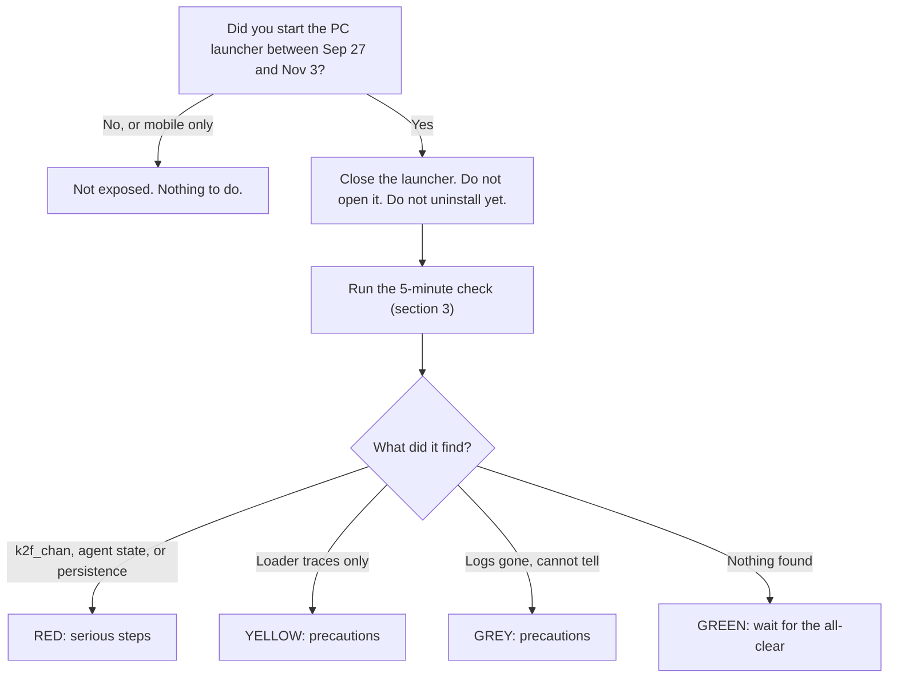

# NIKKE PC launcher incident: what to do, and what not to do

> [!IMPORTANT]
> **Don't panic. Don't wipe, uninstall or reinstall anything yet.** Close the NIKKE launcher and leave it closed until Level Infinite says it is safe. Then spend five minutes checking your PC ([section 3](#3-check-your-pc-5-minutes)) **before** you decide anything. What you need to do depends on what the check finds. For people whose check finds nothing, it is very little.

> [!NOTE]
> Community guide. **Not an official statement.** Not affiliated with SHIFT UP, Level Infinite or Tencent, and not professional incident-response advice. It builds on [MotherSphere's technical report](https://gist.github.com/MotherSphere/d6c049a09ba8ac3085c51ee9df24a4e5), the source for almost every technical detail here. Prepared with AI assistance. Every check is reproducible: see [ANALYSIS.md](ANALYSIS.md).

**Last updated: 2026-11-04, 11:13 GMT**. Things are still changing, so look at the date. Changes are listed in the [changelog](#changelog).

| Status board | Now | Checked (GMT) |
|---|---|---|
| Official CDN files | All four byte-identical to the known-clean versions, on every server tested | Nov 4, 09:56 |
| Publisher statements | First notice posted Nov 4, 03:14. At 08:07, SHIFT UP's Kim Hyung-tae added an apology: they are working with Level Infinite on a fundamental solution and preparing follow-up measures. No scope or advice for players yet | Nov 4, 11:13 |
| Technical report | Newest revision Nov 4, 01:55. 127 comments from 62 people | Nov 4, 09:56 |
| Stolen data being misused | No such report found in the report's comments (absence of reports, not proof) | Nov 4, 09:51 |
| Attacker's server | Reported offline since Nov 3, 18:31 (not verified here) | Nov 4, 09:56 |

## Contents

1. [Start here](#1-start-here)
2. [What everyone can do right now](#2-what-everyone-can-do-right-now)
3. [Check your PC (5 minutes)](#3-check-your-pc-5-minutes)
4. [What to do with the result](#4-what-to-do-with-the-result)
5. [Myths and facts](#5-myths-and-facts)
6. [What is known, and how well](#6-what-is-known-and-how-well)
7. [Timeline (GMT)](#7-timeline-gmt)
8. [Do not get scammed](#8-do-not-get-scammed)
9. [What players still need from SHIFT UP and Level Infinite](#9-what-players-still-need-from-shift-up-and-level-infinite)
10. [Changelog](#changelog)
11. [Sources and credit](#sources-and-credit)

## 1. Start here



Why Sep 27? Four official launcher script files were modified that day, so the first stage (the "loader") was in place from then. The second stage, a remote-control program called the "agent", is first reported on Oct 23. The report covers the PC launcher on Windows and on Linux / Steam Deck (Proton). Mobile was not analysed.

**Being exposed is not the same as being infected.** According to the report, the attack code was delivered on only some launches (one machine got it on 3 of about 19). That is why the check matters.

## 2. What everyone can do right now

These work whatever the result is.

- **Close the launcher and leave it closed.** According to the report, the agent only receives commands while the launcher is open.
- **Check before you uninstall, reinstall or wipe.** Uninstalling deletes `debug.log`, and the launcher's own uninstaller can remove its saved data too. That is your evidence. If you already uninstalled, it is not a disaster: see GREY in section 4.
- **You do not need to switch your PC off or cut your internet.** Closing the launcher is what stops the known attack path. The one reported exception is a Chrome helper DLL, which section 3 checks for.
- **Do not run "fix" tools from anyone**, including strangers on social media (section 8).
- **If you launched in the window, do the 10-minute precautions** in section 4.

## 3. Check your PC (5 minutes)

Do this **before** you uninstall, delete or reinstall anything, and with the launcher closed.

<details>
<summary><b>Manual check, nothing to download</b></summary>

1. Open `NIKKE\Launcher\intl_service\debug.log` in Notepad and search for `k2f_chan`.
   - Found: **RED**.
   - Not found: look at the first date in the file. The log has no year, and lines look like `[1031/211231.145:...]`, which is Oct 31. If it starts after your first launch in the window, it does not cover everything. If the file does not exist, see **GREY**.
2. In `regedit`, look for `HKEY_CURRENT_USER\Software\Classes\CLSID\{E77CC89B-7401-4C04-8CED-149DB35ADD04}`. If it exists, even with an empty value: **RED**. The same CLSID under `HKEY_LOCAL_MACHINE` is normal Windows. Ignore that one.
3. In File Explorer open `%LOCALAPPDATA%\Google\Chrome\User Data\PlatformExperienceHelper\`. A subfolder named with 64 hex characters that contains `platform_experience_helper.dll`: **RED**. The folder itself is normal Chrome. The report says the DLL can be installed even without Chrome.
4. Search the files in `%APPDATA%\nikke_launcher\tbs_cache\Local Storage\leveldb\` for the text `k2f.agent`. Found: **RED**.
5. If you run Pi-hole, NextDNS or look at router logs: a lookup of `insightjs.com` means the loader ran (**YELLOW**). A lookup of `analytics.insightjs.com` suggests the agent stage was reached. A DNS log can miss lookups, so a clean DNS log is not proof.
6. Did the launcher itself show a security warning? That is the loader's fallback page, not proof of infection (see the myths in section 5). It counts as **YELLOW**: the modified script loaded. It says nothing about whether the agent ran, and not seeing it proves nothing either.

</details>

**Prefer a script?** [`Check-NikkeLauncher.ps1`](Check-NikkeLauncher.ps1) does steps 1 to 4 plus a few extras. It is plain PowerShell, offline and read-only, and short enough to read in five minutes. Read it first. Do not run scripts you have not read, including this one.

```
powershell -NoProfile -ExecutionPolicy Bypass -File .\Check-NikkeLauncher.ps1
```

> [!NOTE]
> **A clean log is evidence, not proof.** The agent can run any command your Windows user can run, which in principle includes editing or deleting files. The report documents cleanup commands that delete the agent's *own* download logs and payload files, and says that missing files prove nothing. No report of `debug.log` itself being edited was found in the report's comments (keyword scan, see [ANALYSIS.md](ANALYSIS.md)), but you cannot rule it out from the log alone. That is why the check looks in several places.

## 4. What to do with the result

| Result | What it means | What to do |
|---|---|---|
| **RED**: `k2f_chan` in the log, `k2f.agent` in storage, or the registry key / DLL folder exists | The agent ran. The operator could run any command and read your files. The logs cannot show which. | Follow [RED in detail](#red-in-detail) below. |
| **YELLOW**: loader traces (`insightjs` in cache, DNS or the launcher's download logs, or a security warning shown inside the launcher) but no sign of the agent | The first stage ran. Nothing shows the agent did. | Delete `%APPDATA%\nikke_launcher\tbs_cache`, do the [precautions](#precautions-10-minutes), keep watching your accounts. A wipe is not warranted by this alone. |
| **GREY**: no log and no launcher data left (uninstalled or reinstalled), but you launched in the window | You cannot tell. | Treat it as "possibly exposed": do the [precautions](#precautions-10-minutes). Absence of evidence alone does not justify a wipe, but reconsider if the PC holds high-value secrets. Evidence that survives an uninstall: Windows' SRUM network records (below). |
| **GREEN**: log present, covers your launches, no hits anywhere | No sign the agent ran. | Delete `tbs_cache` before the next launch and wait for the official all-clear. |
| You never started the PC launcher between Sep 27 and Nov 3 | Not exposed. | Nothing to do. |

### RED in detail

1. Close the launcher, or disconnect from the internet, so the operator loses access.
2. **From a different device**, change passwords: NIKKE / Level Infinite first, then email, Discord, Steam, banking and everything saved in your browsers. Turn on 2FA.
3. Sign out of **all sessions** everywhere. Stolen browser cookies work without your password.
4. Revoke and regenerate API tokens and SSH keys. Move crypto funds to a new wallet with a new seed phrase.
5. Remove the persistence: delete the HKCU registry key, restart Windows, then delete the 64-hex folder. Do not delete the whole `PlatformExperienceHelper` folder, which is normal Chrome.
6. **Reinstalling Windows is the only way to be certain**, because nothing logs what an operator ran. Whether you do it depends on what the PC holds (wallets, keys, work access). Keep your other drives, but check programs and scripts changed since Oct 23 before running them. A System Restore point is not a clean state.

### Precautions (10 minutes)

For anyone who launched in the window and is not sure.

- From another device, change your NIKKE / Level Infinite password and use "sign out of all sessions".
- Do the same for email, Discord, Steam and Google / Microsoft. Look at their "recent activity" pages for logins you do not recognise. Make sure 2FA is on.
- If you saved passwords in a browser on that PC, change the important ones (email, banking, crypto).
- Delete `%APPDATA%\nikke_launcher\tbs_cache` before the launcher is opened again, and do not open it until Level Infinite confirms the fix. They have not said "all clear" yet.
- Blocking the attacker's domains or IPs (the report lists them) is optional and of limited value. It only stops the current server, and the attacker could switch to a new one. Do not rely on it: closing the launcher and the steps above matter more.

<details>
<summary><b>If you already uninstalled: SRUM can still tell you something</b></summary>

SRUM (`C:\Windows\System32\sru\SRUDB.dat`) keeps hours of data sent per program, usually about a month back, and it survives uninstalling. Open it as administrator with NirSoft NetworkUsageView or SrumECmd and look at `tbs_browser.exe` in the hours you launched.

People in the report's comments show anything from about 0.4 MB to over 100 MB sent in the hour an agent started, and one agent start shows only 12 KB. So an ordinary hour **lowers** your concern but does not clear you.

</details>

## 5. Myths and facts

| You may hear | What the evidence says |
|---|---|
| "It's a hoax." | SHIFT UP's own notice reports an anomaly consistent with tampering, and the registry, certificate and CDN details in the report match independent checks. The details of the payload rest on one researcher plus community reports. |
| "It's just one person's PC, a minor local issue." | No. Many independent players report the same traces, the publisher replaced the official files at the times the report gave, and files on two different CDN host names (`na-webassets` and `sg-gpts`) were involved. |
| "Everything on every PC was stolen." | Only if the agent ran, and the report says the attack code was served on only some launches, and several players in its comments found no sign of the agent. Exposure is not infection. |
| "The attacker had no time, nothing was stolen." | Nobody can say that for a specific PC. The report says a first collection starts within seconds of the agent starting (reported). On the other side, no misuse of stolen data has been reported in the report's comments so far. Both are true: it is unknown, and there is no sign of misuse yet. |
| "A clean log means I'm safe." | It is good evidence, not proof (see the note in section 3). |
| "The launcher showed a security warning, so I'm infected." | Not by itself. The warning comes from a page on `insightjs.org`, registered on Nov 3 after the incident became public. By the report's description, the modified script falls back to that address when it cannot reach the attacker's server, for example because the address was blocked or the server went offline. So the warning means the modified script loaded (YELLOW), not that the agent ran. Seeing no warning proves nothing either. The log decides. |
| "I have to wipe Windows." | Only the RED result calls for it, and even then it is the way to be *certain*. For YELLOW, GREY and GREEN the evidence so far does not justify it. |
| "I have to switch off my PC and cut the internet." | No. Close the launcher. If you find RED, disconnect while you sort out your passwords from another device. |
| "Uninstalling the launcher fixes it." | It stops new exposure but undoes nothing, and it erases your evidence. |
| "Blocking the attacker's IP or domain protects me." | It only stops one server. The report notes the attacker could try again with a new domain, because how they got write access to the CDN is still unknown. It does not replace closing the launcher and checking your PC. |
| "Changing my NIKKE password is enough." | It is the first step, not the only one. Saved browser passwords, cookies and tokens can be targeted if the agent ran. |
| "Only Windows is affected." | The report also covers Linux and Steam Deck (Proton), where an agent start is reported. |

### Short answers you can copy

Short replies for people asking in threads and chats. Each one fits in a post.

- **"Do I need to wipe Windows?"** Not automatically. Close the launcher, don't uninstall yet, and check `debug.log` for `k2f_chan` first. A hit means the agent ran, and then a reinstall is the only way to be certain. https://github.com/SpringZali/nikke-launcher-triage
- **"I already uninstalled it. Am I fine?"** You can't tell from logs, because uninstalling deletes them. Do the 10-minute precautions (change passwords from another device, sign out of all sessions) and don't panic-wipe. https://github.com/SpringZali/nikke-launcher-triage
- **"Is it a hoax?"** No. SHIFT UP's own notice reports an anomaly consistent with tampering, and the domain, certificate and CDN details check out. What is not confirmed yet is how many players got the second stage. https://github.com/SpringZali/nikke-launcher-triage
- **"I saw a security warning in the launcher. Am I hacked?"** Not necessarily. The warning means the modified script loaded, not that the remote-control program ran. Check ``debug.log`` for ``k2f_chan`` before you uninstall anything. https://github.com/SpringZali/nikke-launcher-triage
- **"Is the launcher safe to open now?"** The official files look clean now, but SHIFT UP has not given an all-clear. Wait for it, and delete `tbs_cache` before you open the launcher again. https://github.com/SpringZali/nikke-launcher-triage
## 6. What is known, and how well

**VERIFIED** = reproduced from a public source. **CORROBORATED** = several independent reports agree. **REPORTED** = one source. Full table with 23 claims and how to reproduce each: [ANALYSIS.md](ANALYSIS.md).

| Fact | How well established | Source |
|---|---|---|
| The publisher reports an anomaly consistent with tampering and applied a client fix | **VERIFIED** | [Official notice, Nov 4](https://x.com/NIKKE_japan/status/2117817740555956289) |
| The official files were replaced on Nov 3 between 17:04 and 17:21 GMT | **VERIFIED** | Current `Last-Modified` headers on the CDN |
| The files served now are the clean versions | **VERIFIED** | [`Check-OfficialCdn.ps1`](Check-OfficialCdn.ps1) |
| `insightjs.com` was registered Sep 27 and `insightjs.org` Nov 3 | **VERIFIED** | Domain registry records |
| Certificates were issued for the attacker's domain on Sep 27, Oct 6, Oct 23 and Oct 24 | **VERIFIED** | Certificate transparency log |
| A remote-control agent was delivered to some launches (`k2f_chan` in the log) | **CORROBORATED** | MotherSphere's report and many independent comments |
| What the agent can do: run commands, read files, take screenshots, collect saved credentials | **REPORTED** | Static analysis by one researcher |
| Chrome-helper persistence | **REPORTED**, not universal | Several victims. Others with the agent have none |
| Stolen data is being misused | **NO REPORTS FOUND** | Keyword scan of 127 comments |
| How the attacker got write access to the CDN | **UNKNOWN** | Not yet explained |

## 7. Timeline (GMT)

| When | What | Status |
|---|---|---|
| Sep 27, 01:59 | `insightjs.com` registered | verified |
| Sep 27, 06:41 to 06:42 | Four official launcher script files modified | reported |
| Oct 6, 00:55 | Certificate for `analytics.insightjs.com` | verified |
| Oct 23, 15:37 | New certificate for the apex, `analytics.`, `portal.` and `www.` | verified |
| Oct 23, 16:40 | Earliest agent start reported | reported |
| Oct 28, 15:46 | One file (`FeedList`) cleaned at the origin. Some CDN servers keep the old copy | reported |
| Nov 3, 16:11 | First public warning (community Discord) | reported |
| Nov 3, 17:04 / 17:13 / 17:21 | Three files replaced with clean versions | verified |
| Nov 3, about 17:30 | Publisher's client fix (02:30 JST on Nov 4), per its notice | official |
| Nov 3, 18:31 | Attacker's server stops answering | reported |
| Nov 3, 20:19 | `FeedList` re-published | verified |
| Nov 3, up to 22:26 | Two CDN servers still serve the modified `FeedList` | reported, matches [Inven Global](https://www.invenglobal.com/articles/28112/goddess-of-victory-nikke-pc-launcher-allegedly-compromised) |
| Nov 4, 03:14 | Publisher's first public statement | verified |
| Nov 4, 08:07 | SHIFT UP's Kim Hyung-tae apologises: working with Level Infinite on a fundamental solution, preparing follow-up measures | verified |
| Nov 4, 09:56 | All four files clean on every server tested | verified |

## 8. Do not get scammed

A "NIKKE virus remover", a "launcher fixer", an `.exe` or `.zip` "cleanup tool", a Discord DM, or a "paste this into PowerShell" one-liner is a likely next wave. A few rules:

- **Never run executables or installers** offered as a fix.
- **Read every script** before you run it. This repository contains only plain text files.
- **Take guidance only from official accounts** and from sources that show how to check them.
- **Never type a password into a "checker".** Nothing here needs one.
- A GitHub link proves nothing by itself. Anyone can publish one in thirty seconds, and that includes this one. What counts is that you can reproduce the claims: [ANALYSIS.md](ANALYSIS.md) shows how.

## 9. What players still need from SHIFT UP and Level Infinite

As of Nov 4, the notice says the scope is under investigation and that guidance will follow separately. A later statement from SHIFT UP's Kim Hyung-tae (08:07 GMT) apologises, says the company and Level Infinite are working on a fundamental solution and promises updates on follow-up measures. Neither gives the scope or advice for players yet. Players still need:

1. **Scope:** which launches, regions and dates were affected.
2. **Credentials:** whether player credentials or sessions were exposed, and clear advice on password changes.
3. **A forced cache reset** in the next launcher update, because old modified files may still sit in `tbs_cache`.
4. **An explicit all-clear**, or the conditions for one, before players relaunch.
5. **How the CDN was accessed**, and confirmation that other files and buckets were checked.
6. **A way to tell** whether an account's sessions were used abnormally.

## Changelog

- **2026-11-04, 11:13, v2.3.** Added SHIFT UP's second statement (Kim Hyung-tae, 08:07 GMT) to the status board, timeline and sources.
- **2026-11-04, 11:00, v2.2.** Added the security-warning nuance: a YELLOW example, manual check step 6, a myth row and a short answer.
- **2026-11-04, 10:28, v2.1.** Added short copy-paste answers and a credit for community review.
- **2026-11-04, 10:11, v2.** Restyled. Added the status board, decision flow, myths and facts, timeline, scam warning and the list of what players still need. Added "a clean log is evidence, not proof" and "no misuse reports found" (keyword scan). Clarified that uninstalling deletes `debug.log` and can remove the saved data too. Clarified that blocking the attacker's IPs is of limited value.
- **2026-11-04, 09:35, v1.** Guide, analysis and two read-only checkers.

## Sources and credit

- [MotherSphere's report](https://gist.github.com/MotherSphere/d6c049a09ba8ac3085c51ee9df24a4e5) and the players who shared their logs and network records in its comments. This guide would not exist without them.
- Official notices, Nov 4: [NIKKE English account](https://x.com/NIKKE_en/status/2117817602659770434) (03:13 GMT) and [NIKKE Japan account](https://x.com/NIKKE_japan/status/2117817740555956289) (03:14 GMT)
- [Kim Hyung-tae of SHIFT UP, statement of Nov 4](https://x.com/jamm3rd/status/2117891546322252242) (08:07 GMT)
- [Inven Global](https://www.invenglobal.com/articles/28112/goddess-of-victory-nikke-pc-launcher-allegedly-compromised) and Japanese coverage: [Inside Games](https://www.inside-games.jp/article/2026/11/04/190338.html), [Mynavi](https://news.mynavi.jp/article/20261104-5254830/), [Automaton](https://automaton-media.com/articles/newsjp/20261104-477333/)
- **Review and feedback:** [Necromancer](https://github.com/necromancer124), a community member who is learning IT, reviewed the draft and suggested the log-tampering caveat.

Maintained by @SpringZ_FSG. Corrections are welcome: open an issue and include a source.
